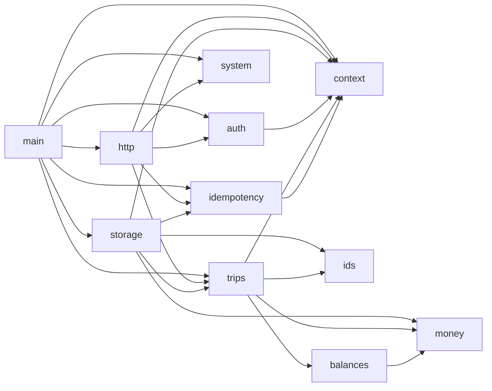

# Архітектура SplitTrip — лаба 2

Статус: прийнято · Вхід: [spec.md](spec.md), [contract.md](contract.md).
Доповнює [архітектуру лаби 1](../lab1-foundation/architecture.md): модель даних, інваріанти
I1–I6 і сценарії 1–11 чинні; цей документ замінює розд. 2–3 (модулі й залежності) і додає
сценарії 12–13.

## 1. Шари → модулі

| Шар з умови лаби | Модуль | Знає про |
|---|---|---|
| Роути | `http` | HTTP: Fastify, схеми запитів, заголовки, коди, `problem+json` |
| Сервіси | `trips` | Сценарії, доступ власника, доменні помилки; порт `TripRepository` |
| Репозиторії / DAO | `storage` | SQL, транзакції, `FOR UPDATE`, ретраї, міграції; memory-реалізація |
| — (наскрізне) | `context` | AsyncLocalStorage `{ processId, userId }`, логер з `mixin` (ADR-0016) |
| — (адаптер) | `auth` | Supabase Auth HTTP API, перевірка JWT (ADR-0017) |
| — (наскрізне) | `idempotency` | Порт сховища ключів, хеш запиту, рішення «виконати / повторити / 409 / 422» (ADR-0019) |
| — (домен) | `money`, `balances` | Без змін з лаби 1 |
| — (утиліта) | `ids` | UUIDv7 на `globalThis.crypto` (без `node:*`) |
| — (адаптер) | `system` | Версія й стан; `/ready` питає `storage` через переданий `ping` |

`src/main.ts` — composition root: пул БД (`SELECT now()` на старті), репозиторії, клієнт
Auth, сервіси, сервер. Вибір `STORAGE=memory|postgres` — лише тут.

## 2. Залежності



Правила (C6, dependency-cruiser; замінюють правила 1–6 лаби 1):

1. Дозволені лише стрілки з графа; імпорт іншого модуля — лише через його `index.ts`; без
   циклів; ніхто не імпортує `main.ts`.
2. `storage` реалізує порти `trips` і `idempotency` — залежність адаптера на домен, не навпаки.
3. Зовнішні пакети: `fastify` — лише `http`; `postgres` — лише `storage`; `jose` — лише
   `auth`; `node:async_hooks` — лише `context`; `node:child_process` — лише `system`;
   `node:crypto` — лише `idempotency` (SHA-256).
4. Доменні `trips`, `balances`, `money`, `ids` не імпортують `node:*` і зовнішніх пакетів;
   `trips` може імпортувати `context` (ADR-0016).
5. `try` заборонено в `http` і `trips` (ESLint, ADR-0021).

## 3. Шлях запиту

```mermaid
sequenceDiagram
  participant C as Клієнт
  participant H as http
  participant X as context
  participant T as trips
  participant S as storage
  participant DB as Postgres
  C->>H: POST /trips/:id/expenses (Bearer, Idempotency-Key)
  H->>H: схема тіла → 400; auth.verify(JWT) → 401
  H->>X: runWithContext({processId, userId})
  H->>H: idempotency.begin → повтор / 409 / 422
  H->>T: addExpense(tripId, input)
  T->>S: update(tripId, mutate)
  S->>DB: BEGIN; SELECT … FOR UPDATE; 3 SELECT агрегату
  S->>T: mutate(trip) → новий Trip або доменна помилка
  S->>DB: INSERT expense + shares; COMMIT (ретрай 40001/40P01 ≤ 3)
  T-->>H: Expense
  H->>H: idempotency.complete; 201
  Note over H: будь-який виняток → setErrorHandler → problem+json
```

## 4. Нові сценарії

| # | Сценарій | Перевірки | Зміна даних |
|---|---|---|---|
| 12 | Список поїздок | — | немає; `owner_id = userId`, курсор за `id` |
| 13 | Видалити поїздку | власник (інакше `404`) | − `TRIP` і каскадом усе дочірнє, будь-який статус |

Доступ власника — у сервісі (умова лаби: «сервіси — про доступи»): `trips` порівнює
`trip.ownerId` з `currentUser()` одразу після завантаження (у `update` — першим кроком
`mutate`) і кидає `NotFoundError` — чужа поїздка для клієнта «не існує» (`404`). Репозиторій
не приймає користувача параметром (spec, крит. 5); лише `list` обмежує вибірку `owner_id`
ініціатора, читаючи його з `context`, щоб не вантажити чужі поїздки.

## 5. Структура коду

```
src/modules/<модуль>/index.ts   публічний вхід кожного модуля з розд. 1
src/modules/storage/            postgres/*.ts, memory/*.ts, migrate.ts
db/migrations/NNNN-*.sql        міграції (ADR-0020)
supabase/config.toml            локальний Supabase (Docker)
test/api/                       один набір API-тестів для memory і postgres
```
