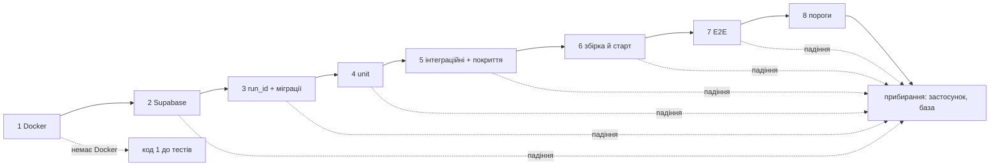

# Архітектура SplitTrip — лаба 3 (тести)

Статус: чернетка · Вхід: [spec.md](spec.md) (прийнято, `579129e`).
Розвиває [архітектуру лаби 2](../lab2-api-db/architecture.md): модулі, межі (C6) і шлях
запиту не змінюються; HTTP API — [contract.md лаби 2](../lab2-api-db/contract.md) без змін.
`src/` змінюється лише коментарями `Stryker disable` (крит. 14) і фіксами знайдених багів
(spec, «Обмеження»). Документ описує тести, команди й конвеєр.

## 1. Рівні тестів → файли й команди (spec, «Рівні тестів»; крит. 1, 4, 13)

| Рівень | Файли | Залежності | Команда |
|---|---|---|---|
| Unit | `test/unit/*.test.ts` | без БД і Supabase; фейки в процесі | `npm run test:unit` |
| API на `memory` (не рівень) | `test/api/*.test.ts` | `app.inject`, memory-сховище, фейк Auth | `npm run test:api` (C11) |
| Інтеграційні | `test/api/*.test.ts`, `STORAGE=postgres` | `app.inject`, `run_<id>`, локальний Supabase Auth | `npm run test:api:db` (C12), `npm test` |
| E2E | `test/e2e/*.test.ts` | `dist/main.js` окремим процесом, `run_<id>`, Supabase Auth, `fetch` | `npm test` |
| Smoke (C8, поза рівнями spec) | `test/smoke/*.test.ts` | `dist/main.js` на `memory` | `npm run smoke` |

- E2E — чорна скринька: імпортує лише `node:*` і `test/e2e/client.ts`, нічого з `src/`
  (конвенція; C6 сканує лише `src/`).
- Stryker ганяє мутанти проти unit і API на `memory` (крит. 13), без Docker.

## 2. `npm test` — оркестратор (крит. 1, 6–8)

`npm test` = `node scripts/test-all.ts`. Спільне з `test:api:db` винесено в `scripts/run-db.ts`:
створити `run_<id>`, накотити `db/migrations`, видалити (`drop … with (force)`), env
інтеграційних (`STORAGE=postgres`, `DATABASE_URL`, `SUPABASE_URL`, `SUPABASE_ANON_KEY`,
`SUPABASE_SIGNING_KEYS`). `scripts/test-db.ts` переходить на нього без зміни поведінки (C12).



| # | Етап | Як |
|---|---|---|
| 1 | Docker | `docker info`; немає CLI (`ENOENT`) або код ≠ 0 → код 1 ще до тестів (крит. 7) |
| 2 | Supabase | `npx supabase status -o env`; код ≠ 0 → `npm run db:start` (ключ підпису + `supabase start`); після прогону не зупиняється (spec, «Не входить») |
| 3 | База | `run_<id>` + міграції (`run-db.ts`, ADR-0020) |
| 4 | unit | `npm run test:unit` — разом зі звітом покриття `balances` (крит. 2) |
| 5 | інтеграційні | `npm run test:cov` з env бази прогону → `coverage/lcov.info` (розд. 4) |
| 6 | застосунок | `npm run build`; `node dist/main.js` (розд. 3); чекати `GET /ready` = 200 ≤ 20 с; процес завершився або таймаут → провал етапу з хвостом логу |
| 7 | E2E | `node --test --test-timeout=60000 test/e2e/*.test.ts` з `E2E_BASE_URL` |
| 8 | пороги | `node scripts/check-coverage.ts coverage/lcov.info` (крит. 3) |
| — | `finally` | зупинити застосунок (SIGTERM, за 5 с — SIGKILL), потім видалити базу (крит. 8) |

- Етапи йдуть послідовно; перший провал зупиняє решту (як `npm run check`), далі — лише
  прибирання. Код 0 — лише якщо пройшли всі етапи й прибирання (крит. 7).
- Дочірні процеси — `spawn` з pipe: вивід іде в консоль і збирається; `npm`/`npx` — через
  shell, як у `demo-guards.ts`. Перед етапом — `== [N/8] <етап> ==`, наприкінці — таблиця
  «етап · OK / ПОМИЛКА / пропущено · тривалість» (крит. 1). SIGINT/SIGTERM — як падіння
  поточного етапу.
- `npm test -- --report` ще й пише вивід у `reports/npm-test.txt`: рядок 1 —
  `# Відтворити: npm test -- --report (потрібен Docker)`, далі `# HEAD`, `# Код виходу`.

**Чому етап 5 проганяє й unit-тести.** Вбудоване покриття Node зводить процеси лише в межах
одного запуску `node --test`. Два lcov не об'єднати: Node нумерує гілки `BRDA` індексом, а
V8 зливає блоки з лічильником, як у батьківського, тож набір гілок залежить від прогону.
Крит. 4 вимагає покриття на unit + інтеграційних, тому етап 5 — один запуск над `test/unit`
і `test/api` (unit повторюються, ≈ 0,3 с). Власний підсумок рівня дає репортер
`scripts/level-summary.ts`: рахує тести за каталогом файлу (`test/unit/` → unit,
`test/api/` → інтеграційні або «API (memory)» за `STORAGE`). Окремий етап покриття з повторним
прогоном інтеграційних на тій самій базі неможливий: `postgres.test.ts` створює
`test_fault_*` без `if not exists` і не прибирає їх (розд. 10, В2).

**E2E на тій самій `run_<id>`.** Крит. 6 називає одну базу. E2E реєструє власних
користувачів, тож дані інтеграційних тестів йому невидимі (доступ власника, розд. 4
архітектури лаби 2), а тригер `test_fault` спрацьовує лише для поїздки зі своєї таблиці налаштувань. Окрема
база не дала б повної ізоляції: користувачі Supabase Auth (`auth.users` у базі `postgres`)
спільні для всіх прогонів.

## 3. E2E (крит. 9–12)

Застосунок стартує оркестратор (етап 6), а не тест-файл: E2E-файли йдуть паралельно без
повторного старту, а крит. 6 зупиняє застосунок наприкінці. Як у smoke (ADR-0004): вільний
порт через `listen(0)`, `HOST=127.0.0.1`, без `--env-file`. Env застосунку = env
інтеграційних без `APP_VERSION` і `NODE_V8_COVERAGE`, плюс `PORT`, `HOST`; вивід — у
`coverage/e2e-app.log` (не в репо).

`test/e2e/client.ts`: `E2E_BASE_URL` (немає → помилка під час імпорту, не пропуск);
`request(method, path, { token, body, headers })` → `{ status, headers, body }`; `newUser()` =
`POST /auth/signup` (201) + `POST /auth/login` (200) через справжній Supabase Auth, email
`e2e-<uuid>@example.com`.

| Файл | Крит. | Кроки → коди за contract.md |
|---|---|---|
| `journey.test.ts` | 9 | signup 201 → login 200 → `POST /trips` 201 → 3 × participants 201 → витрати `equal` і `exact` 201 → balances 200 (≠ 0, Σ = 0) → settlements 200 → кожен запропонований `POST /transfers` 201 → balances 200, усі 0 → `close` 200, `status: closed` |
| `access.test.ts` | 10 | користувач Б: `GET /trips/:idA` 404, `POST /trips/:idA/participants` 404; А: `POST /auth/logout` 204 → `POST /auth/refresh` старим refresh-токеном 401 |
| `idempotency.test.ts` | 11 | два послідовні `POST /trips/:id/expenses` з одним `Idempotency-Key` і тілом → обидва 201, той самий `id`; `GET /trips/:id` → одна витрата |
| `version.test.ts` | 12 | `GET /version` 200, `version` = `git rev-parse HEAD`, виконаний у тесті; git недоступний → провал, а не пропуск |

Оркестратор не передає `APP_VERSION`, інакше крит. 12 перевіряв би відлуння env, а не
`resolveVersion` через git.

**Перекриття зі smoke.** Smoke (C8) теж порівнює `/version` з HEAD, але м'якше: без git
допускає `unknown`. Він працює на `memory`, без Docker, на кожен пуш, і ще перевіряє
`APP_VERSION` та запасний `unknown`. E2E перевіряє суворо, на повному стеку — це доказ для
DEFENSE §4. Лишаються обидва: умови й тригери запуску різні, дублюється одне твердження.

## 4. Покриття (крит. 2–5)

Вбудоване покриття Node 24 (`--experimental-test-coverage`), без нових залежностей (007,
п. 3). Вбудовані пороги `--test-coverage-*` перевіряють лише сумарний відсоток усіх файлів,
тому пороги на файл рахує власний скрипт.

- **Пороги (крит. 3)** — `scripts/check-coverage.ts <lcov>`: читає записи
  `SF`/`BRF`/`BRH`/`LF`/`LH` lcov-репортера Node, порівнює з таблицею нижче (вона живе в
  скрипті) і друкує «файл · гілки % (BRH/BRF) · поріг · OK / НИЖЧЕ». Нижче порогу → код 1.
  Немає lcov, запису файлу чи `BRF = 0` → код 1 «не вдалося перевірити» (checks.md: помилка
  інструмента = провал).

  | Файл | Гілки |
  |---|---|
  | `src/modules/money/index.ts`, `trips/domain.ts`, `trips/service.ts`, `idempotency/index.ts` | ≥ 90% |
  | `src/modules/balances/index.ts` | 100% |

- **Що міряється (крит. 4).** `npm run test:cov` — один запуск над `test/unit` і `test/api`
  з `--test-coverage-include=src/**/*.ts` і репортерами `spec` → stdout,
  `./scripts/level-summary.ts` → stdout, `lcov` → `coverage/lcov.info`. Без env — API на
  `memory`: так у check і pre-push (`npm run coverage` = `test:cov` + `check-coverage`). З env
  бази прогону — інтеграційні: так у `npm test` (етапи 5 і 8).
- **Звіт unit (крит. 2).** `npm run test:unit` додає `--experimental-test-coverage
  --test-coverage-include=src/modules/balances/index.ts`: таблиця spec-репортера показує
  рядки й гілки `balances` лише від unit-тестів. Це звіт, а не поріг: поріг на `balances` у
  check дає C13 (крит. 3; В4).
- «Гілка» — у метриці Node: кожен блоковий діапазон V8, зокрема тіло функції й правий
  операнд `??`/`||`. У цій метриці виміряно й числа з 006a/009a (`balances` — 91,3%).
- **Поріг падає (крит. 5, C10).** Новий сценарій `npm run demo` —
  `09-coverage-threshold-rejected`. У тимчасовому клоні з unit-тестів `balances` прибирається
  тест, який єдиний покриває гілку, недосяжну через API (учасник поза списком у
  `computeBalances`). `npm run check` падає на `check-coverage` з рядком `balances … НИЖЧЕ`,
  попередні кроки check зелені. Docker не потрібен.

## 5. Мутації (крит. 13–17)

`npm run mutation` = `node scripts/mutation.ts [before|after]`: два запуски Stryker
послідовно, обидва — навіть якщо перший упав; env `STORAGE=memory`, `NO_COLOR=1`. Код
виходу ненульовий, якщо ненульовий хоч один запуск.

| Конфіг | `mutate` | `thresholds.break` | HTML (не в репо) |
|---|---|---|---|
| `stryker.balances.config.js` | `src/modules/balances/index.ts` | 100 | `coverage/mutation/balances.html` |
| `stryker.config.js` (база) | `money/index.ts`, `trips/domain.ts`, `trips/service.ts` | `null` | `coverage/mutation/domain.html` |

Поріг Stryker один на запуск (бал усіх мутованих файлів), тому `break` 100% лише на
`balances` (крит. 14) — це окремий запуск. Конфіг balances імпортує базовий і перевизначає
`mutate`, `thresholds`, `htmlReporter`.

Базовий конфіг:
- `testRunner: 'tap'` (`@stryker-mutator/tap-runner`);
- `tap.testFiles: ['test/unit/*.test.ts', 'test/api/*.test.ts']`; `postgres.test.ts` на
  `memory` пропускається;
- типові `nodeArgs` (`--test-reporter=tap -r {{hookFile}} {{testFile}}`): `.ts` виконує сам
  Node 24 (type stripping), без `buildCommand` і `tsx`;
- `coverageAnalysis: 'perTest'` (у tap-runner покриття рахується на тест-файл);
- `reporters: ['clear-text', 'html']` без `progress`, `clearTextReporter.allowColor: false`;
- `tempDirName: '.stryker-tmp'`, `cleanTempDir: 'always'`.

Якщо tap-runner не запрацює з type stripping (П1–П3), запасний варіант — `testRunner:
'command'`, `commandRunner.command: 'node --test test/unit/*.test.ts test/api/*.test.ts'`,
`coverageAnalysis: 'off'`.

- **Звіти (крит. 16).** З аргументом `before` / `after` скрипт пише
  `reports/mutation-<arg>.txt`. Рядок 1 — `# Відтворити: npm run mutation -- <arg>`, далі
  `# HEAD`, `# Код виходу`, потім для кожного запуску `$ npx stryker run <конфіг>`, вивід і
  `[код виходу: N]` (формат `demo-guards.ts`). Звіт «до» ненульовий через `break` на
  `balances`; якщо вижилих у `balances` не виявиться, це висновок і spec-fix (010a, п. 2).
- **Аналіз (крит. 15, 17)** — `reports/mutation-analysis.md`:
  1. бал «до → після» для кожного запуску й файлу;
  2. таблиця вижилих мутантів зі звіту «до» (`Survived` і `NoCoverage`): `#` · файл:рядок ·
     мутатор і зміна · чому вижив · клас (реальна прогалина / еквівалентний / прийнятний) ·
     дія (тест і коміт / `Stryker disable` / лишається з причиною);
  3. топ-3 «реальна прогалина»: мутант (файл:рядок, зміна) → тест → коміт `test: …` →
     статус у звіті «після».
  Номери рядків беруться зі звіту «до»: коментарі `Stryker disable` зсувають рядки.
- **Еквівалентні (крит. 14)** — рядок над кодом:
  `// Stryker disable next-line <Мутатор>: еквівалентний — <причина>` (один мутатор, не
  `all`). У звіті такий мутант має статус `Ignored` і в бал не входить. На `balances` клас
  «прийнятний» неможливий: вижилий мутант або вбивається тестом, або еквівалентний, інакше
  `break` 100% не пройде.

## 6. Конвеєр і перевірки (крит. 4, 19)

Hook-и в `.husky/` не змінюються: вони викликають `npm run pre-commit|pre-push`.

| Скрипт `package.json` | Зміна |
|---|---|
| `test` | новий: `node scripts/test-all.ts` |
| `test:unit` | + покриття `balances` (розд. 4) |
| `test:cov` | новий: unit + API, покриття, lcov (розд. 4) |
| `coverage` | новий: `npm run test:cov && node scripts/check-coverage.ts coverage/lcov.info` |
| `mutation` | новий: `node scripts/mutation.ts` |
| `check`, `pre-push` | після `test:api` — `&& npm run coverage` |

`test:unit` і `test:api` лишаються в check окремими кроками (C11 — окрема перевірка), хоча
`coverage` проганяє ті самі файли ще раз: unit + API на `memory` триває ≈ 1,3 с (звіт
`01-clean-clone-check` лаби 2).

| Перевірка | Що з лаби 3 покриває |
|---|---|
| C1, C2, C5 | нові `scripts/*.ts`, `test/e2e/*.ts`; конфіги Stryker `.js` — під правилами JS у ESLint; `.stryker-tmp/` — у `ignores` ESLint і `.gitignore` |
| C3 | HTML Stryker і lcov — у `coverage/` (уже заборонено) |
| C6 | межі `src/` без змін — лишається architecture.md лаби 2 |
| C8, C11, C12 | без змін; `test-db.ts` переходить на `run-db.ts` |
| C10 | + сценарій 09; звіти — у `reports/` лаби 3 (В3) |
| C13 (нова) | пороги покриття на файл, unit + API на `memory`; check, pre-push |
| C14 (нова) | `npm test`: усі рівні + пороги C13 на unit + інтеграційних; вручну, звіт |
| C15 (нова) | `npm run mutation`, `break` 100% на `balances`; вручну, звіти «до»/«після» |

`npm test` і `npm run mutation` у hook-и не входять: перший потребує Docker, другий триває
хвилини (007, п. 9; 010, п. 5).

## 7. Стандарти, ADR, README, DEFENSE (крит. 18–21)

- DoD 0.3 (крит. 18) і checks.md 0.5 (крит. 19) — нові версії стандартів. Їх приймає автор
  окремими комітами до першого коміту реалізації (DoD 0.2).
- ADR (крит. 20): Stryker і запуск тестів під ним; вбудоване покриття з порогами на файл;
  оркестрація `npm test` і рівні тестів.
- README: рядок лаби 3 → DEFENSE (крит. 21); команди `npm test`, `coverage`, `mutation` і
  виправлений опис `test:unit`; залежності Stryker з «навіщо» й ADR; Docker — і для
  `npm test`; `test/e2e/`; pre-push — ще й покриття.
- DEFENSE (пише автор): §5 спирається на `mutation-before.txt`, `mutation-after.txt`,
  `mutation-analysis.md` і коміти `test: …`; §4 — на `npm-test.txt` (sha `/version`).

## 8. Порядок реалізації

Spec не впорядковує ці критерії, але між ними є залежності:

1. Stryker (конфіги, `mutation.ts`, залежності, README) → `npm run mutation -- before` **на
   тестах лаби 2** (крит. 13, 14, 16). Якщо спершу дописати unit-тести `balances` (крит. 2),
   вижилих у ньому може не лишитися, і звіт «до» не буде ненульовим.
2. `mutation-analysis.md` — класифікація вижилих (крит. 15).
3. Коміти `test: …` для топ-3 (крит. 17); решта тестів `balances` до 100/100 (крит. 2, В1);
   `Stryker disable` для еквівалентних (крит. 14). Баг → спершу червоний тест, потім фікс.
4. Покриття: `test:unit`, `test:cov`, `check-coverage.ts`, `coverage` у check і pre-push,
   сценарій demo (крит. 2–5). Лише коли пороги вже виконуються, інакше pre-push заблокує
   власні коміти.
5. `run-db.ts`, `test-all.ts`, `level-summary.ts`, E2E (крит. 1, 6–12).
6. `npm run mutation -- after`, `npm test -- --report`, `npm run demo`.

## 9. Розкладка файлів

```
package.json                     скрипти (розд. 6), devDependencies Stryker
stryker.config.js                Stryker: база + money, trips/domain, trips/service
stryker.balances.config.js       Stryker: balances, break 100
.gitignore, eslint.config.js     + .stryker-tmp/
README.md                        розд. 7
scripts/test-all.ts              npm test (розд. 2)
scripts/run-db.ts                run_<id> і env інтеграційних — спільне з test-db.ts
scripts/test-db.ts               C12 на run-db.ts
scripts/check-coverage.ts        C13: пороги на файл з lcov
scripts/level-summary.ts         репортер node:test: підсумок за рівнями
scripts/mutation.ts              npm run mutation, звіти before/after
scripts/demo-guards.ts           + сценарій 09; звіти → reports/ лаби 3
test/unit/balances.test.ts       balances: повне покриття (крит. 2), з domain.test.ts
test/unit/*.test.ts              тести-підсилення (крит. 17)
test/e2e/client.ts               fetch-клієнт, newUser()
test/e2e/{journey,access,idempotency,version}.test.ts
src/modules/**                   лише Stryker disable і фікси багів
docs/specs/lab3-testing/reports/ npm-test.txt, mutation-{before,after}.txt,
                                 mutation-analysis.md, 01–09 (demo)
coverage/                        lcov.info, mutation/*.html, e2e-app.log — не в репо
```

## 10. Припущення й відкриті питання

**Непідтверджені припущення** (перевіряє перший сеанс реалізації):

- П1. tap-runner із типовими `nodeArgs` запускає `.ts` через type stripping Node 24 без
  `tsx`, а хук `-r {{hookFile}}` працює в ESM-проєкті. Перевірка:
  `npx stryker run stryker.balances.config.js --dryRunOnly --logLevel debug`.
- П2. Код, інструментований Stryker 10 (`// @ts-nocheck`, перемикачі мутантів), лишається
  стираним TS, і Node його приймає. Перевірка — той самий dry run і звичайний запуск.
- П3. tap-runner правильно читає TAP `node:test` із вкладеними `describe` і `{ skip }`;
  паралельні воркери не конфліктують між собою.
- П4. Як tap-runner показує статичні мутанти, що виконуються під час імпорту (`MAX_AMOUNT`,
  `ZERO`, `IDEMPOTENCY_*`): документація каже, що він їх не розпізнає. Видно у звіті «до».
- П5. V8 рахує правий операнд `??` окремою гілкою, тож `totals.get(participantId) ?? ZERO`
  (`balances/index.ts:55`) — гілка, недосяжна жодним тестом (ключі `totals` — рівно
  `participantIds`). Тоді 100% гілок на `balances` без зміни `src/` недосяжні (В1).
- П6. `--test-reporter-destination=coverage/lcov.info` сам створює `coverage/`; репортер
  `./scripts/level-summary.ts` завантажується як `.ts` і отримує `data.file`.
- П7. `npx supabase status -o env` завершується з кодом ≠ 0, коли Supabase не запущено.
- П8. Unit-тести не залежать від `STORAGE` і проходять в одному запуску з інтеграційними.
- П9. `npm run mutation` триває прийнятно (оцінка — 300–400 мутантів); виміряти.

**Відкриті питання до автора:**

- В1. Недосяжна гілка `balances` (П5) проти крит. 2–3. Варіанти: (а) коментар
  `/* node:coverage ignore next */` із причиною; (б) переписати рядок без `??`; (в) у
  крит. 2–3 рахувати лише досяжні гілки. (а) і (б) змінюють `src/` поза дозволеним, (в)
  змінює критерій — для кожного потрібна spec-fix.
- В2. Етап 5 — один запуск unit + інтеграційних із покриттям, як описано вище, чи окремий
  етап покриття з повторним прогоном у другій `run_<id>` (оцінка +20–30 с, дві бази)?
- В3. `npm run demo` пише всі сценарії в `reports/` лаби 3 (check змінився, а DoD вимагає
  звіт чистого клону для PR) чи лише сценарій 09?
- В4. Крит. 2 — лише звіт у `test:unit` чи ще й вбудований поріг 100/100? З порогом
  сценарій 09 впаде на `test:unit`, а не на C13.
- В5. `@stryker-mutator/typescript-checker`: з ним мутанти з помилками типів відкидаються
  (`CompileError`) ціною +1 залежності й повільнішого запуску; без нього вони виконуються
  (type stripping типів не перевіряє) і, вижившись, потребують ручної класифікації.
  Вирішити до звіту «до».
- В6. `Stryker disable` для еквівалентних — у всіх чотирьох модулях чи лише в `balances`?
